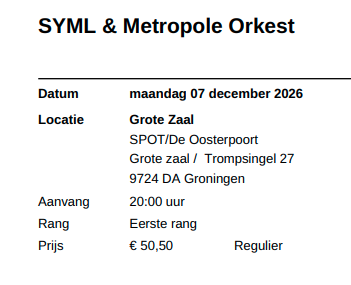
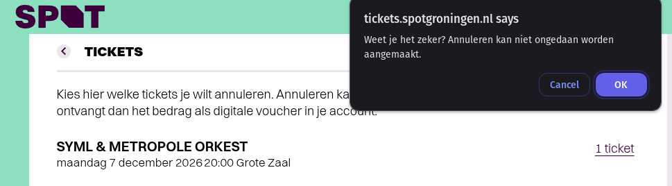

](banner.png)

Shop offline and you will hear jazz or the most popular pop music right now.
Go to the gym and you will hear music with powerful beats.
Visit Don Don Donki and you will be hypnotized by their jingle.
Stand in the elevator and you will hear catchy chimes (or ads).

Music has always been around me. But for the longest time, I never really paid attention to it.

All this time, I only listened to music based on the most popular ones. I don't really have any taste. When I hear something, I might think it's good, but I won't be able to answer why it's good. Is it the melody? Is it the chorus? Is it the lyrics? Is that it?

## A Wildfire

Until, in 2019, on my lowest low (at that time), I was desperate. Stuff happened. Stuff went wrong. I didn't know where to start -- or when to pause. Too many things crossing my mind. Too many things occupying my head.

But then, YouTube randomly played a vocal song. Right after my queue of instrumental songs from OSTs.

> Darling, please take my hand
> Please get up, rise to stand
> I can't be the one to sing your song (song, song)
> 'Cause I believe it's not your fault
> 
> Don't be scared, you are my rock
> Nothing's gonna hold you down for long (long, long)
> Sometimes we break so beautiful
> And you know you're not the only one
> I breathe you in, so sweet and powerful
> Like a wildfire burning up inside my lungs
> I'm burning up, ooh, ooh, ooh, ooh
> I'm burning up, ooh, ooh, ooh, ooh
> I'm burning up
>
> In good time, you'll come to know
> When you release, when you let go
> You can find yourself where you belong (belong, belong)
> You're not a curse, you're not too much
> You are needed here, you are enough
> And nothing's gonna hold you down for long (for long, for long)

What.

Wait what. I was not familiar with the voice. But, why were the lyrics,... so,... poignant with my current situation? What an algorithm.

Then I immediately checked on the tab playing the song. The song's called ["Wildfire"](https://youtu.be/9ihU5SKEiP4?si=cGRP0nYKkjaNA6gB) and is sung by SYML. Hmmm. 

<figure class="article-video">
  <iframe
    src="https://www.youtube.com/embed/9ihU5SKEiP4"
    title="Wildfire by SYML [Official Music Video]"
    allow="accelerometer; clipboard-write; encrypted-media; gyroscope; picture-in-picture; web-share"
    allowfullscreen>
  </iframe>
  <figcaption>"Wildfire" by SYML [Official Music Video]</figcaption>
</figure>

Wait.

The moment I saw the music video, I was suddenly,.. crying? Why were my tears suddenly gushing down? Why do I relate to the characters in the music video? And why was the main character a girl who had tanned skin -- just like me (I am slightly tanned), of all people?

Oh shit lol currently my eyes are sweaty again as I write this article. 

Ok focus.

Whatever I was doing at that time, at my first exposure to this song, I dropped it. I watched the MV again and again. All night and until dawn. I still remember that my mom asked me why my eyes were so puffy in the morning. I said that I couldn't sleep well. And then I went to college as usual. No one bothered to ask about my eyes. But inside my head? ["Wildfire"](https://youtu.be/9ihU5SKEiP4?si=cGRP0nYKkjaNA6gB) was still playing on loop.

> Please get up, rise to stand

As someone who was on her lowest low.

> I can't be the one to sing your song

As someone who was doubting herself.

> 'Cause I believe it's not your fault

As someone who was trying to find what went wrong.

All of the lyrics were a direct hit to my fragile heart. They were something that felt like a helping hand to the me who was drowning deep.

And the lyrics after?

> Nothing's gonna hold you down for long 

An encouragement to the me that I would get better in the near future.

> Sometimes we break so beautiful

An acknowledgement that whatever happened to me at that time, and whatever my reaction was at that time, were valid.

> And you know you're not the only one

A reassurance that everyone had their own lows too, in a world where everyone aims to have the most perfect social presence.

> In good time, you'll come to know
> When you release, when you let go
> You can find yourself where you belong (belong, belong)

Little did the me back then know, that I would make one of the most influential decisions of my life, three months later. A large step for me to make such a decision even though _everyone_ advised me against it. One of my best decisions in my life though.

Oh and the music too! 

A metronome that subtly sounds like clapping slowly. Like someone encouraging us from the sidelines.

A poppy, energetic arrangement. Almost like a push to keep moving forward.

The slow and steady progression. Just like how character development works. 

This didn't feel like another melancholy song trying to relate to me. Or a happy-go-lucky song trying to advise me on being happy. This song directly reassured me that everything I was feeling, was valid. In that kind of situation, I needed that.

## More than a Wildfire

I did some exploration on SYML, a solo project by Brian Fennell. Apparently, his first song for SYML, ["Where's my Love"](https://youtu.be/43k-NKTdimg?si=PKJX22j5R9bb8-wX) was the viral one. Well, about a day before writing this article, the song had passed 1 billion streams on Spotify! Congrats Brian!

Somehow, YouTube recommended me ["Wildfire"](https://youtu.be/9ihU5SKEiP4?si=cGRP0nYKkjaNA6gB) instead? I hope that trackers were not at work back then. But, I really thank YouTube for doing it. I survived back then.

["Where's my Love"](https://youtu.be/43k-NKTdimg?si=PKJX22j5R9bb8-wX) was a banger song too though. ["Fear of the Water"](https://youtu.be/geaySHvw5iU?si=AkxtIqZgQMFmk0sC), SYML's most popular MV, too. And all of his other songs. I played them on repeat. From 2019 until now.

SYML easily became my top artist in Spotify for years straight.

I liked SYML so much. Not only the lyrics, but how Brian explores music. He does not follow the cookie-cutter pattern of chorus. He explores on his own. Even between his songs, they may have their own characteristics. From the powerful ["Everything all at once"](https://youtu.be/U_-iJOKU8jQ?si=MuOrGMRv_rI8O06i), to the falsetto and beat drop ["The Bird"](https://youtu.be/vni9PvOWdTk?si=Pe0GXERz5HrJjIro), to the confessional ["The War"](https://youtu.be/NT0TRUYiIy8?si=jmZzCWJfY_bGfSA9), to the heavy electronica ["Who put blood in my drink?"](https://youtu.be/_ywMK6oRR3Q?si=YNfYmq9NahzJc28Y), to the warm ["Please Slow Down"](https://youtu.be/iu9Lk7ruYJQ?si=kiM00ZsNI1T1Zd01), etc. I can make the list go on forever.

> I would describe my genre as a mix of cinematic singer-songwriter, with a tinge of alternative and a dash of electronic. My music doesn’t sound as obnoxious as that sounds though. Honestly, I think I belong to a genre that has been developing over the past few years that borrows from established genres. I think some might see that as sacrilegious, but that’s how all categories of art are formed and understood.
> [Wonderland. New Noise: SYML](https://www.wonderlandmagazine.com/2021/04/16/new-noise-syml/)

Here are some other SYML songs that became particularly meaningful to me. Top 1 belongs to ["Wildfire"](https://youtu.be/9ihU5SKEiP4?si=cGRP0nYKkjaNA6gB). I spent quite a long time finding my top songs as I have certain events engraved to each song that made them memorable.

### ["I Wanted to Leave"](https://www.youtube.com/watch?v=ZPItV_q1u38&list=OLAK5uy_l4xQnZqB0o7tKMcmw_cQ6K51nmHNAFX_8)

<figure class="article-video">
  <iframe
    src="https://www.youtube.com/embed/ZPItV_q1u38?list=OLAK5uy_l4xQnZqB0o7tKMcmw_cQ6K51nmHNAFX_8"
    title="I Wanted to Leave by SYML [Official Music Video]"
    allow="accelerometer; clipboard-write; encrypted-media; gyroscope; picture-in-picture; web-share"
    allowfullscreen>
  </iframe>
  <figcaption>"I Wanted to Leave" by SYML [Official Music Video]</figcaption>
</figure>

One of my first piano series by SYML.

I used to play instrumental music on loop, but this felt different. 
You can hear the sounds of the string stutters. The sound of the piano pedals stomping. The sounds of,.. human.

Not long after I looped this for hours a day, I discovered there was an MV. A series to this instrumental (["You knew it was me"](https://www.youtube.com/watch?v=ZPItV_q1u38&list=OLAK5uy_l4xQnZqB0o7tKMcmw_cQ6K51nmHNAFX_8)). A story about an accident that took away someone's passion and the person decided to start again despite her disabilities.

Oh as I was writing this article, "I Wanted to Leave" got played on YouTube Station.
](station.png)

I have so many memories of this particular piece. And on my birthday, someone close to me gave me the lossless version of this. I can't thank him enough.

### ["Connor"](https://youtu.be/vRXiOvCqdr8?si=v45o42Vgx6xmTWsB)

<figure class="article-video">
  <iframe
    src="https://www.youtube.com/embed/vRXiOvCqdr8"
    title="Connor by SYML [Official Audio]"
    allow="accelerometer; clipboard-write; encrypted-media; gyroscope; picture-in-picture; web-share"
    allowfullscreen>
  </iframe>
  <figcaption>"Connor" by SYML [Official Audio]</figcaption>
</figure>

The music was about fatherhood. But I relate to the part of feeling unprepared for the future.

> It's coming in phases
> And I'm ready for none
> I knew it would change me
> And the man I become

Like, we know that the future will come, inevitably, whether we are prepared or not. 
And everything we went through will change us. For better or for worse.

This piece helped me cope with the uncertainty of the future. Several times.

We can't decide which tracks life will play for us. The hardships, the joys, the challenges, or the people who will support us along the way.

And, we could never be fully ready. As someone who decides with "second-order thinking" (read: overthinking), this song helped me to find the stopping checkpoint.

### ["The Walker"](https://youtu.be/bOEarfH0KA0?si=V48mYQ7rSHjTeW4C)

<figure class="article-video">
  <iframe
    src="https://www.youtube.com/embed/bOEarfH0KA0"
    title="The Walker by SYML [Official Music Video]"
    allow="accelerometer; clipboard-write; encrypted-media; gyroscope; picture-in-picture; web-share"
    allowfullscreen>
  </iframe>
  <figcaption>"The Walker" by SYML [Official Music Video]</figcaption>
</figure>

This song resonated with my competition life.

When I was still a newbie among the giants.

> When your heart rips out your chest
> When your voice is tremblin'
> Lift your head to the blood-red moon
> Hold your pain as you breathe

Until the moment I felt I was better suited to managerial positions. Until the moment I walked on stage to accompany my team.

Until the moment I first led a competition and had to stand in front of hundreds of people. I tried to stay standing, legs trembling, heartbeat spiking, slightly sweating.

> Walk on in the middle of a dark day fighting through hell
> I will walk with you

Even though I had practiced giving the talk several times, I made mistakes on stage. But I was truly grateful that the audience was not as angry as I had imagined them to be. They notified me when my screen was outdated. When I was done, people were clapping for me.

> Walk on at the edge of the world where you find yourself
> I will walk with you

At that time, I didn't have the courage to talk in front of people. The last time I did that was in high school, and it failed miserably.

> Walk on with your burden (up), walk on with your burden (down)
> I will walk with you

And years later, I found myself casually speaking in front of CTOs, foreign representatives, parents, and bystanders, all at one event, in a stage, and livestreamed (1.9k views as of this article writing).

### ["Oblivion"](https://youtu.be/hdmrlPArh68?si=nHh_nAFxKueiOIxQ)

<figure class="article-video">
  <iframe
    src="https://www.youtube.com/embed/hdmrlPArh68"
    title="Oblivion by SYML [Official Audio]"
    allow="accelerometer; clipboard-write; encrypted-media; gyroscope; picture-in-picture; web-share"
    allowfullscreen>
  </iframe>
  <figcaption>"Oblivion" by SYML [Official Audio]</figcaption>
</figure>

There was one time that I felt betrayed. My work credit got taken. My reputation got slandered. All by the same person I used to help during his lows, before the person got power.

As I was getting disappointed, not angry, but disappointed, Oblivion came to me.

> And lo, watch as I will rise
> Lo, watch me come alive

Yes, I will not surrender to your slanders. I will keep my ground.

> Don't question what your hands have built

Thank you for seeing my work as something notable to take, but I will hold on to it. I will not surrender my credits. I will stand where I stand.

<!-- ### ["Sweet Home"](https://youtu.be/Ey9xpu69jPo?si=tPMVH-AkCfdF33Xn) -->

### ["Sweet Home"](https://youtu.be/Ey9xpu69jPo?si=tPMVH-AkCfdF33Xn)

<figure class="article-video">
  <iframe
    src="https://www.youtube.com/embed/Ey9xpu69jPo"
    title="Sweet Home by SYML [Official Audio]"
    allow="accelerometer; clipboard-write; encrypted-media; gyroscope; picture-in-picture; web-share"
    allowfullscreen>
  </iframe>
  <figcaption>"Sweet Home" by SYML [Official Audio]</figcaption>
</figure>

People say that home is where we feel we belong. I had always wanted to live in an apartment. I didn't care if it was rented or owned. I just wanted to experience living in one.

And that wish came true.

My previous kostan (boarding house) was becoming too small. I had lived there for,.. 7 years. A ~12m² room.
A long time it was, 7 years. A lot of things happened to me. A lot of new things I experienced. These left me feeling suffocated in that room. I needed to move. This kostan couldn't contain me properly anymore. I need to move.

After growing desperate from not finding a good apartment in a good environment within my budget, an agent suddenly contacted me to say she had an offer that fitted my request. I paid right after surveying, because it was exactly the place I needed. Even after a year of living here, circumstances kept drawing me toward this particular unit (read the ["Unreal Estate"](/articles/unreal-estate) article series).

So what made a home feel like a home?

> Letters written in the den
> Folded news and coffee cans
> Simple things that I recall
> Not forgotten easily

Yep, the little details, the little things that hotels or staying at someone else's place can't offer.

Though the song was about home as a person, I kinda interpreted it as my apartment. My first bucket-list item, checked.

In a book I read recently, ["The Prophet" by Kahlil Gibran](https://www.kahlilgibran.com/images/The%20Prophet%20Ebook%20by%20Kahlil%20Gibran.pdf), there was a chapter about "Houses". It was said that a house shouldn't be a permanent possession -- a house should be a living extension of oneself.

> Welcome home
> Your last and only one
> Never more to roam
> Have no fear if you don't see the sun
> I will hold you close

Was it that I felt at home because I chose to reside here? Because this was the place I decorated from emptiness? Was it that I felt at home because I left so many little things -- little pieces of me and my memories -- here, scattered around the corners of the room?

I stayed at a friend's place for three whole weeks to escape the haze in Indonesia, and I felt empty. I missed the scent of my slightly humid bedroom. I missed my home so much that I missed doing my chores at home. I missed the pieces of me I left behind. I felt that there was no way I could just leave those pieces behind with no reason and act like they don't exist. If I had to move one day, I will bring the things that mattered to me the most and peacefully part ways with the other things needing to be left behind. Those things are the extensions of me, those things are my home.

> Welcome home, you are home
> No nothing tastes like sweet
> Sweet home

And this song was what came to me when I finally got home again.

### ["DIM"](https://youtu.be/jufDF-ZOd8s?si=j79nFnBUpO18cxBH)

<figure class="article-video">
  <iframe
    src="https://www.youtube.com/embed/jufDF-ZOd8s"
    title="DIM (Recorded at St. Mark's Cathedral) by SYML [Official Lyric Video]"
    allow="accelerometer; clipboard-write; encrypted-media; gyroscope; picture-in-picture; web-share"
    allowfullscreen>
  </iframe>
  <figcaption>"DIM" (Recorded at St. Mark's Cathedral) by SYML [Official Lyric Video]</figcaption>
</figure>

> I lay next to myself, breathing slow
> Car crash in rewind
> "There's nothing you could have done", said a soft voice
> "Calm down, you will survive"
> Leave me out of my mind, sedated
> Bitter and blurry-eyed
> Please don't look me in my face when I'm wasted
> You know you can't relate

This song reminded me of how short our life is, but at the same time how rich our life could possibly be.

This song reminded me of how we can meet people for the first time, but at the same time for the last time.

Not only other people. 
We might get a new opportunity tomorrow. Or breathe for the last time tonight.

A song to stay grounded. A song to remember that we are alive.
A song of finiteness.

## Hearing SYML live, I wish I could

All my life, all this time, I only had two bucket lists:

1. Stay in an apartment all by myself.
2. Listen to SYML live.

That's it.

The apartment one? Checked. I have one of the apartments that I truly liked and I am currently living here. See ["Sweet Home"](#sweet-home) section.

The second bucket list? Yep, it's watching SYML live.
I put this on my bucket list because I wanted it, but I have never been close to reaching it.

](show.png#70)

SYML had mostly toured America and Europe. As much as I wanted to watch him live, you know, the difficulties Indonesians face when applying for a Schengen visa.

But then, something happened. I got the visa! Thanks to the European Women's Programming Contest for inviting me to be part of the committee, making me receive the multiple-entry Schengen visa ❤️

A week after receiving the visa, it clicked. Wait, this means I can watch SYML live in Europe if he was touring.

](metropole_orkest.png#50)

When I checked for the SYML tour dates, I was expecting him to do another solo show. But,... SYML was collaborating with the Netherlands' top-tier orchestra team: [Metropole Orkest](https://www.mo.nl/en/)!!! Dating back to 1945, they've won multiple Grammys and are even supported by the Dutch Ministry of Culture!

When I thought the price would be expensive, nope. The concert tickets to Novo Amor in Jakarta were.. priced similarly(?) Like how???? 

Oh shit there are barely any seats left. 

OH THERES A SEAT ON THE FIRST ROW (of the seat group)! I need that seat as I am short and the Netherlands got the tallest people on average.

I rushed in to buy the tickets. Immediately. I didn't even plan my trip there. I needed to secure the tickets first. And then I bought a ticket for me.

For months, I had imagined how majestic it would be to hear Brian live. To hear his voice elevated by the grand orchestra. To hear his creations live in the realest way possible.

But yea, things didn't go well and I had to say goodbye to the ticket :(

Just like I had to let go of my very first concert ticket to Novo Amor live because of the intersecting dates with the ICPC Asia Pacific Championship 2024, I had to let this ticket go too. A 100% track record of skipping concerts of my life-changing artists, a track record that I'm not proud of. 

It was hard to let this go, really. I had mourned for a week and clicking the annull button was really hard for me. Roughly just 3 weeks before the event. It was really hard for me to accept that I won't be going. And, since that I was certain I can't go, I'd prefer to annull the ticket as soon as possible so the slot could go to someone else who can go and be there.

I wish I could have gone but stuff happened. I pulled some tarot cards (yes, I had tarot guide me sometimes), and I got wands and major arcana cards. I wanted to go, I thought I could go. I don't know when I'll get another opportunity. But I hope there will be one. Before my Schengen visa expires. Hopefully.

Wait for me, SYML.
